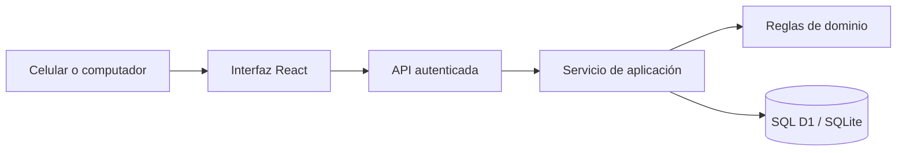

# Alcance y arquitectura del MVP

## 1. Decisión: monolito modular con capas

Una aplicación web, una API y una base SQL para **un solo parqueadero**, inicialmente en El Retiro, Antioquia. Los módulos funcionales son estadías, tarifas, pagos, caja y reportes. Se despliegan juntos. No hay empresas, sedes ni aislamiento multiempresa en esta versión.

Separación de responsabilidades:

| Capa         | Ubicación                                                 | Responsabilidad                                                  |
| ------------ | --------------------------------------------------------- | ---------------------------------------------------------------- |
| Presentación | `app/parking-app.tsx`, `app/globals.css`                  | Formularios responsive, búsqueda, cobro, impresión y exportación |
| Entrada HTTP | `app/api/parking/route.ts`                                | Identidad, validación de solicitudes y traducción de errores     |
| Aplicación   | `application/parking-service.ts`                          | Casos de uso y coordinación de escrituras atómicas               |
| Dominio      | `domain/billing.mjs`                                      | Placas, liquidación por bloques y calendario de Colombia         |
| Persistencia | `db/`, `drizzle/` y consultas parametrizadas del servicio | Tablas, restricciones, migraciones y garantías de concurrencia   |

El servicio recibe la base de datos y el reloj como dependencias. Las pruebas ejecutan ese mismo servicio y las migraciones reales sobre SQLite. La API es el único punto que conoce el entorno del alojamiento y la identidad de la sesión. Las consultas SQL están centralizadas en el servicio en esta primera versión; si se incorpora otro motor, se extraerá un repositorio sin cambiar el cálculo de tarifas.

### Razones técnicas

- **Monolito:** un parqueadero necesita consistencia entre salida, pago y caja. Una sola base permite guardar estos cambios en la misma transacción y reduce infraestructura.
- **React + TypeScript:** formularios e interfaz adaptable, con verificación estática y un lenguaje compartido con el servidor.
- **Vinext + Vite:** runtime compatible con el modelo de rutas de Next sobre Cloudflare Workers, integrado con el alojamiento de esta versión. Está fijado por el lockfile. Vinext es beta: hay que probar actualizaciones en un entorno separado antes de usarlas en operación.
- **D1/SQLite + Drizzle:** SQL persistente y migraciones versionadas. D1 se proporciona en el alojamiento; la base local está separada y nunca se sube al repo.
- **Sin microservicios:** añadirían comunicación entre servicios, despliegues y reconciliaciones sin una necesidad actual. Si en el futuro existe una frontera real de escala o equipos, se podrá separar reportes o facturación primero.

La arquitectura no depende de microservicios para crecer. La expansión multiempresa requerirá diseño explícito de identidad, permisos, pertenencias y aislamiento de datos; no bastará con añadir una columna sin revisar todas las consultas.

## 2. Funcionalidades incluidas

1. Configurar nombre, municipio, dirección, NIT, datos de póliza y contacto de reclamación.
2. Registrar carro o moto por placa y observación del estado al ingreso.
3. Generar automáticamente fecha/hora del servidor y recibo de entrada imprimible.
4. Buscar estadías activas por placa y filtrar por tipo de vehículo.
5. Configurar precio de bloque, duración y tolerancia por tipo.
6. Liquidar y registrar pago en efectivo, transferencia o tarjeta.
7. Registrar salida y pago juntos, emitir comprobante y reimprimir pagos anteriores.
8. Abrir caja con base, registrar movimientos justificados y cerrar con conteo y diferencia.
9. Consultar pagos por fechas y medio de pago; exportar CSV.
10. Registrar operador y eventos de auditoría de las operaciones de escritura.

## 3. Reglas de negocio

### Placas y tiempos

- Se eliminan espacios/guiones y se convierte a mayúsculas.
- Carro: tres letras y tres dígitos (`ABC123`). Moto: tres letras, dos dígitos y una letra opcional (`ABC12D` o `ABC12`). Matrículas especiales/extranjeras no están incluidas.
- Una placa solo puede tener una estadía activa; un índice único parcial lo garantiza incluso con solicitudes simultáneas.
- El servidor fija entrada, liquidación, pago y salida. El navegador no puede enviar una hora de entrada arbitraria.
- Se guardan instantes UTC como milisegundos; la presentación y el día contable usan `America/Bogota`.
- Una estadía puede cruzar medianoche y durar varios días. No existe límite diario ni tarifa nocturna.

### Tarifas

- COP en pesos enteros. Valores iniciales **ficticios/editables**: carro $4.000 y moto $2.000 por hora o fracción. No representan una tarifa autorizada para El Retiro.
- Bloques configurables de 1, 15, 30 o 60 minutos. El precio es el valor por bloque, no un valor horario convertido automáticamente.
- Se cobra cada bloque iniciado: `ceil(duración / bloque) × precio`.
- Tolerancia configurable entre 0 y 60 minutos. Si la duración es menor o igual a la tolerancia, el cobro es cero. Si la supera, se liquida **todo** el tiempo por bloques. La tolerancia no se descuenta.
- En el instante exacto de entrada, duración cero implica cobro cero. Cualquier tiempo positivo sin tolerancia inicia un bloque.
- Se guarda una copia de tarifa e información del negocio en la estadía. Los cambios aplican solo a entradas nuevas.
- Cotización del servidor válida por 60 segundos. El importe se congela durante ese plazo; la salida queda fechada al confirmar el pago. Vencido el plazo, se debe actualizar el cobro.
- No hay descuentos, cortesías manuales, topes diarios, abonos ni mensualidades en esta versión.

Ejemplo, carro de $4.000 por bloque de 60 minutos sin tolerancia: 59 minutos → $4.000; 60 minutos exactos → $4.000; 60 minutos y 1 milisegundo → $8.000.

### Pagos y salidas

- La estadía sigue activa hasta confirmar el pago.
- Se exige un turno de caja abierto para registrar cualquier medio, incluidos pagos digitales y cobros de cero pesos.
- En efectivo, recibido ≥ total y cambio = recibido − total. Los pagos digitales registran exactamente el total.
- Transferencia/tarjeta son registros manuales de un pago que el operador debe verificar; no existe pasarela ni conciliación bancaria automática.
- Un pago por estadía y un pago por cotización, mediante índices únicos.
- Reintentar la misma cotización pagada devuelve el comprobante existente. No se vuelve a cobrar.
- Pago, salida y evento de auditoría se escriben con `batch()` atómico. Si una sentencia falla, se revierte el conjunto.
- Triggers validan caja abierta, estadía activa y correspondencia/validez de la cotización al insertar el pago.
- No se ofrecen eliminación, edición de pagos, anulaciones ni reapertura de turnos. Esas funciones requieren un flujo posterior de reversos y permisos.

### Caja

- Solo un turno abierto a la vez; varios navegadores autenticados comparten ese turno.
- El turno puede cruzar medianoche; no se cierra automáticamente.
- Efectivo esperado = base + pagos en efectivo + ingresos de caja − retiros.
- Las ventas por tarjeta/transferencia cuentan como recaudo, pero no como efectivo físico.
- Los movimientos requieren motivo. Un retiro no puede dejar efectivo esperado negativo.
- Al cerrar se guarda esperado, contado y diferencia = contado − esperado; el saldo se calcula dentro de la actualización SQL.
- Si un pago y un cierre compiten, el pago queda incluido si se confirma antes del cierre; si el cierre ocurre primero, el trigger rechaza el pago. La estadía permanece activa y se cobra en un nuevo turno.
- El dinero de una caja cerrada no se lleva automáticamente a la siguiente base: el operador cuenta y registra la nueva base.

### Reportes

- Las ventas se agrupan por **fecha de pago** en Colombia, no por entrada ni por apertura del turno.
- Rango de máximo 93 días; detalle por placa, tipo, entrada, salida, medio e importe.
- El panel muestra conteos activos, recaudo de hoy y últimas 15 salidas. El historial de caja muestra los últimos 15 turnos.
- El reporte es operativo: no calcula IVA, renta ni obligaciones tributarias, no sustituye contabilidad ni factura electrónica.

## 4. Modelo de datos

| Tabla     | Propósito                                         | Garantías                                                   |
| --------- | ------------------------------------------------- | ----------------------------------------------------------- |
| settings  | Configuración única del negocio                   | Fila id 1 gestionada por la aplicación                      |
| stays     | Entrada, salida, placa y copias de tarifa/negocio | Placa activa única; tipo válido; salida posterior a entrada |
| quotes    | Liquidación temporal persistida                   | Referencia a estadía; total, bloques y vencimiento          |
| payments  | Cobro asociado a estadía y turno                  | Estadía y cotización únicas; importe y medio válidos        |
| shifts    | Apertura, conteo y cierre                         | Un turno abierto; base/conteo no negativos                  |
| movements | Ingresos/retiros de efectivo                      | Turno abierto, importe no cero y saldo no negativo          |
| audit     | Evento, fecha y operador                          | Se escribe con las operaciones de negocio                   |

Los registros de auditoría no son un libro fiscal inmutable frente a quien administre directamente la base. La aplicación no ofrece edición ni borrado de esos eventos.

## 5. Acceso y seguridad

La publicación inicial es **privada para su propietario** y usa inicio de sesión de la plataforma. La página y cada operación de API requieren identidad. No se han implementado roles de administrador/cajero ni invitaciones a empleados. Compartir el sitio exigirá revisar la política de acceso y los permisos antes de usarlo con otros operadores.

Las consultas son parametrizadas; el servidor valida tipos, importes y longitudes. Las mutaciones requieren JSON y un encabezado personalizado, con validación de origen. No se habilita CORS. Las respuestas operativas usan `Cache-Control: no-store`. React escapa el texto que ingresan los operadores.

El inicio de sesión simulado se usa únicamente en desarrollo local sobre loopback y no forma parte de la autenticación publicada. No exponer `npm run dev` a Internet.

## 6. Límites y siguientes etapas

El MVP requiere conexión a Internet para operar. No registra pendientes offline ni maneja barreras, cámaras, lectores, reservas, capacidad física, turnos por empleado o un sistema de factura electrónica. No incluye restauración desde la interfaz ni copias programadas; se deben definir respaldo, retención y recuperación antes de uso real.

Orden sugerido posterior: validar operación con el negocio → roles y reversos auditados → respaldos con ensayo de restauración → facturación mediante proveedor → dispositivos → multiempresa con aislamiento probado.

## 7. Referencias

- [Transacciones batch de D1](https://developers.cloudflare.com/d1/worker-api/d1-database/#batch): base de la escritura atómica del pago y salida.
- [Documentación de Vinext](https://github.com/cloudflare/vinext): runtime de aplicación.
- [Drizzle con D1](https://orm.drizzle.team/docs/get-started/d1-new): esquema y migraciones.
- [Ley 1480 de 2011, artículo 18](https://cancilleria.gov.co/normograma/compilacion/docs/ley_1480_2011.htm): información del recibo de parqueadero.

La interfaz permite capturar datos necesarios para los recibos, pero esto no certifica cumplimiento normativo. Antes de operar, confirma con el municipio las condiciones y tarifas aplicables al establecimiento, completa los datos reales del negocio y revisa facturación y tratamiento de datos con quienes te asesoren.
