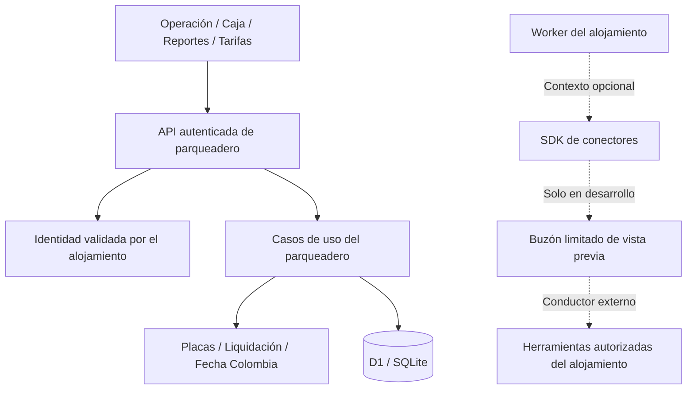

# Revisión de prototipo a producto

## Mapa antes de modificar

Se revisaron la interfaz, la API, el servicio de aplicación, dominio, esquema, migraciones, autenticación, Worker, puente de conectores, scripts de instalación/vista previa, pruebas y flujo de calidad. Línea base: commit `cd3af82`, con verificación y SonarQube aprobados.

El sistema es un monolito con una base SQL para un parqueadero. Se conserva esa decisión: el pago, la salida y la caja requieren consistencia transaccional y no necesitan microservicios.

No existe un orquestador LLM dentro de la aplicación, ni llamadas a modelos, claves de proveedores de IA o herramientas invocadas desde los flujos del parqueadero. El puente opcional pertenece al alojamiento y no está conectado a las operaciones del producto. No se añadirá una conversación ni una función de IA sin un caso de uso y una integración reales.

## Capacidades comprobadas

| Área          | Capacidades actuales                                                                     |
| ------------- | ---------------------------------------------------------------------------------------- |
| Estadías      | Carros/motos, placa normalizada, estado declarado, hora del servidor, placa activa única |
| Cobro         | Tarifa conservada al ingresar, bloques y tolerancia, liquidación válida 60 segundos      |
| Pago y salida | Efectivo/cambio, registro manual digital, pago único y reintentos idempotentes           |
| Caja          | Un turno abierto, base, ingresos/retiros con motivo, saldo y cierre con diferencia       |
| Resultados    | Recibos de entrada/pago, reimpresión de pagos, reporte por fecha de pago y CSV           |
| Seguridad     | Publicación privada, identidad por petición, SQL parametrizado, transacciones y triggers |
| Calidad       | Pruebas del dominio, servicio y vista previa; compilación, tipos y análisis Sonar        |

## Diagnóstico

- La pantalla principal concentra más de 1.500 líneas, con estado y reglas de presentación mezclados. El patrón `Record<string, any>` hace que la interfaz confíe en respuestas sin un contrato comprobado.
- Los mensajes de bienvenida y tarjetas repetidas ocupan espacio antes de la tarea principal. La entrada aparece tanto en una columna como en un diálogo.
- El refresco puede solaparse y sobrescribir información reciente con una respuesta antigua. Los errores de red no distinguen bien una lectura fallida de una escritura de resultado incierto.
- Las etiquetas, botones y promesas reportados por Sonar se corrigieron en la línea base; se mantendrán al reconstruir los módulos.
- La fecha del CSV no incluye año; los formatos, manejo de errores y estados de resultado no son componentes reutilizables.
- La caja tiene buenas garantías en SQL, pero carece de un resumen completo por medio para el turno abierto. El historial y el recaudo del día no son equivalentes al saldo del turno.
- Los movimientos de efectivo requieren protección de reintento, al igual que los pagos. La auditoría de cierre puede duplicarse si dos intentos usan el mismo instante.
- Hay una biblioteca extensa de componentes de plantilla sin consumidores en la aplicación. El SDK de conectores es independiente del trabajo del parqueadero.
- El acceso es del propietario; no hay roles de empleados, multiempresa, banco/datáfono conectado, facturación electrónica, operación offline ni respaldo/restauración desde la interfaz.

## Elementos reutilizables

Se conservan el dominio de liquidación, las transacciones de pago/salida, las restricciones SQL, la autenticación del alojamiento y el circuito de calidad. Se extraen componentes de formularios, diálogos, recibos, estados, navegación, formatos y exportación, junto con un contrato validado compartido y un controlador de datos.

## Implementación incremental acordada

1. Contratos comprobados entre API e interfaz; fortalecer errores, límites de solicitud e integridad de reintentos.
2. Separar datos, formatos y módulos por tarea, conservando las operaciones disponibles.
3. Reorganizar Operación alrededor de placa, vehículos presentes y registro de entrada; hacer explícitos los estados y el resultado del cobro.
4. Dar a Caja un resumen del turno, movimientos y cierre verificables; a Reportes filtros, totales y detalle; a Tarifas un formulario que preserve cambios sin guardar.
5. Mantener la paleta verde/crema, navegación adaptable, controles accesibles y recibos imprimibles. Retirar la plantilla sin consumidores una vez comprobadas las importaciones.
6. Verificar dominio, API, interfaz, fallos, responsive y accesibilidad; ejecutar instalación, tipos, pruebas, compilación y Sonar; publicar la versión validada.

Se priorizan mejoras del trabajo actual. No se modifican tarifas reales, historial de negocio, esquema multiempresa o permisos de acceso como parte de la revisión visual.

## Resultado implementado

- Operación muestra primero las estadías: búsqueda de placa, atajo `/`, filtros con conteos, orden por antigüedad, paginación y acciones de recibo/cobro. En escritorio convive con un único formulario de entrada; en móvil se alterna entre entrada y salida.
- El cobro presenta la placa, tiempo, tarifa conservada, valor reservado, vencimiento, medio, recibido y cambio. Transferencias y tarjetas requieren marcar que se verificaron por fuera del sistema. El resultado es un comprobante recuperable, con referencias completas.
- Caja distingue el recaudo del turno del efectivo físico. Expone la ecuación base + ventas en efectivo + ingresos − retiros y pide revisar el conteo antes de cerrar. El resumen y el cierre definitivo vienen del servidor.
- Reportes conserva el período consultado, distingue fechas editadas de fechas aplicadas, pagina el detalle y exporta todas las filas del período con año, hora de Colombia y protección de fórmulas CSV.
- Tarifas y datos conserva el formulario durante la actualización automática y advierte al navegar o cerrar con cambios pendientes.
- Formularios, diálogos, avisos, estados de carga, formatos y acceso HTTP son módulos compartidos. Los contratos Zod validan entradas y respuestas; TypeScript deriva los tipos de esos contratos. Se retiraron la biblioteca de plantilla sin consumidores y 18 dependencias de aplicación que solo la soportaban.
- La carga descarta respuestas antiguas, conserva la última consulta durante un fallo y bloquea escrituras hasta recuperar datos. Los errores distinguen una lectura fallida de una escritura que pudo guardarse. Los movimientos usan una referencia estable de reintento y una única validación de repetición.
- Se limita el cuerpo HTTP por bytes recibidos antes de interpretarlo. Se conservan autenticación privada, SQL parametrizado, transacciones y restricciones de base. No hay secretos nuevos ni claves de IA.

## Validación y límites

Se añadieron pruebas de contrato y límite HTTP, repetición concurrente de movimientos, auditoría única de cierre y recorridos DOM del producto. `npm test` ejecuta 33 casos de núcleo/SQLite/herramientas y 22 de interfaz/cliente HTTP. También se ejecutan tipos, ESLint y compilación. Los reportes LCOV de ambos grupos se envían a Sonar, sin excluir las pantallas.

La aceptación en navegador local recorrió entrada, pago con cambio, comprobante, cierre y consulta del reporte con registros ficticios. Se revisaron escritorio y un viewport de 390 × 844, con tabla de estadías y tarifas sin desbordamiento de página, controles etiquetados y botones con tipo explícito. No se detectaron errores de consola durante ese recorrido. La revisión DOM y manual no sustituye una auditoría completa con tecnologías de asistencia.

Integraciones verificadas: identidad del alojamiento y rechazo de identidad falsificada en desarrollo; API HTTP con sesión, caché y origen; persistencia local del Worker y D1; migraciones reales en SQLite; ciclo y límites del puente opcional de vista previa. GitHub Actions y Sonar verifican la versión subida. No se han integrado banco, datáfono, facturación o proveedor LLM.

Antes de operación real quedan roles de empleados y permisos por acción, respaldos/restauración ensayados, datos/tarifas del establecimiento, prueba con impresora física y validación en los dispositivos del negocio. Anulaciones con auditoría, operación offline e integraciones de cobro requieren diseño propio. Se mantiene un solo parqueadero; no se añade multiempresa.
